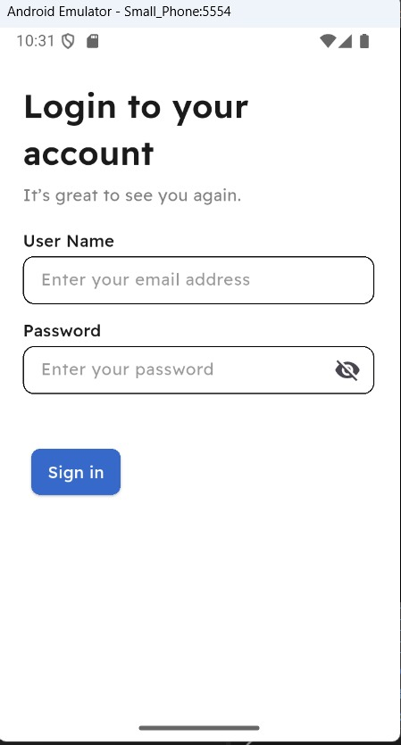
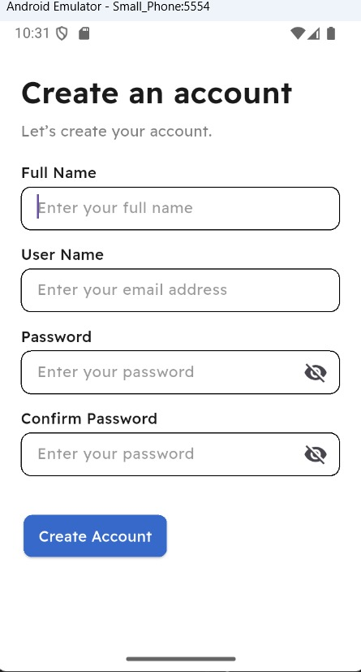
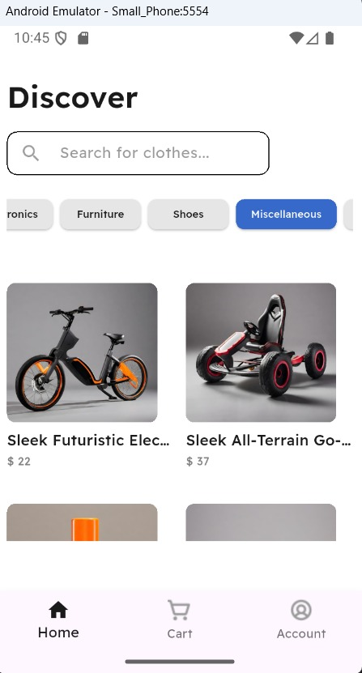
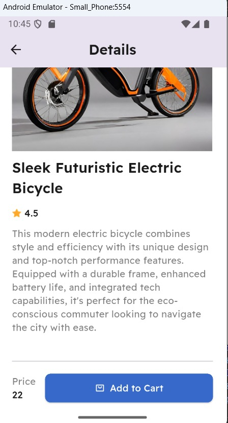
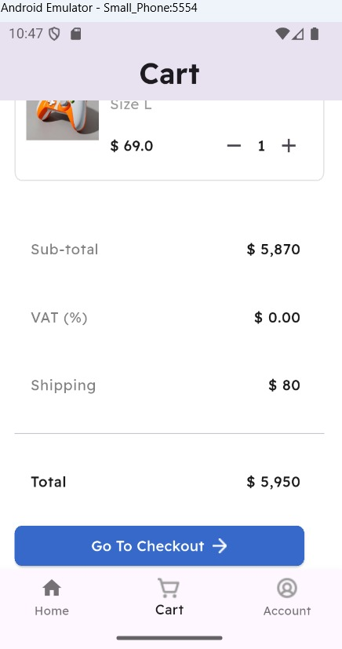
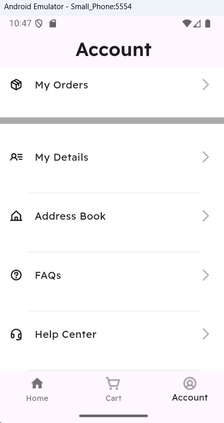
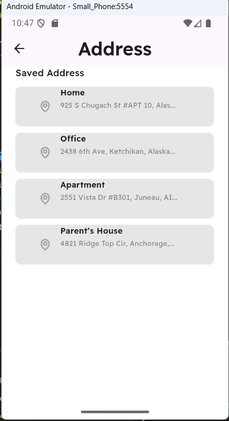

# E-Commerce App 🛍️

A Flutter e-commerce application that lets users discover products, browse categories, search the catalog, view product details, and manage a shopping cart through a clean mobile interface. The app uses the EscuelaJS Fake Store REST API for products, categories, login, and account registration.

The application is built with Flutter and Dart, with Cubit/BLoC for state management, GoRouter for navigation, and local storage for cart data and authentication tokens.

---

## 📱 Screenshots

Screenshots are included in the `protiflo/shots/` folder.

| Login Screen | Create Account Screen |
|:---:|:---:|
|  |  |

| Home / Discover Screen | Product Details Screen |
|:---:|:---:|
|  |  |

| Cart Screen | Account Screen |
|:---:|:---:|
|  |  |

| Address Book Screen |
|:---:|
|  |

---

## ✨ Features

- Register a new account and sign in through the REST API.
- Validate registration and login form inputs.
- Browse products loaded from the API.
- Browse the catalog by product category, including an All category.
- Search products by title.
- Open a dedicated product details screen with an image, title, description, and price.
- Add products to the shopping cart.
- Increase or decrease item quantities and remove items from the cart.
- Persist cart contents locally with `SharedPreferences`, so the saved cart can be restored after reopening the app.
- Store access and refresh tokens using `flutter_secure_storage` after a successful login.
- Navigate between Home, Cart, and Account using the bottom navigation bar.
- Display an account area with an address book screen and logout action.
- Use responsive sizing with `flutter_screenutil`.
- Organize features into dedicated UI, Cubit, repository, model, and widget files.

> **Current scope:** The checkout button is a UI entry point only. Checkout/payment processing is not connected yet, and the subtotal, VAT, shipping, and total displayed in the current cart screen are sample values. The saved addresses shown in the address screen are sample UI entries.

---

## 🛠️ Technologies Used

- **Flutter** — cross-platform mobile UI.
- **Dart** — application programming language.
- **EscuelaJS Fake Store API** — product catalog, categories, registration, and authentication endpoints.
- **Dio** — HTTP requests and API communication.
- **flutter_bloc** — Cubit/BLoC state management.
- **dartz** — `Either`-based repository results.
- **get_it** — dependency injection and service locator.
- **go_router** and **go_transitions** — app routing and screen transitions.
- **flutter_screenutil** — responsive sizing.
- **shared_preferences** — local cart persistence.
- **flutter_secure_storage** — secure local storage for auth tokens.
- **lottie** — animation support.
- **pretty_dio_logger** — Dio request/response logging during development.
- **animated_snack_bar** — feedback messages.
- **shimmer** — loading-placeholder UI support.
- **intl** — formatting utilities.
- **flutter_staggered_animations** — staggered UI animations.

---

## 📂 Project Structure

```text
lib/
├── Core/
│   ├── networking/
│   │   ├── api_endpoints.dart
│   │   └── dio_helper.dart
│   ├── Routing/
│   │   ├── app_router.dart
│   │   └── router_gen.dart
│   ├── Styling/
│   │   ├── Widgets/
│   │   │   ├── customtextfield.dart
│   │   │   ├── loading_widget.dart
│   │   │   └── primarybutton.dart
│   │   ├── app_assets.dart
│   │   ├── app_fonts.dart
│   │   ├── app_style.dart
│   │   ├── app_theme.dart
│   │   └── appcolor.dart
│   └── utils/
│       ├── animated_snack_bar.dart
│       ├── service_locator.dart
│       └── storage_helper.dart
│
├── Features/
│   ├── Auth/
│   │   ├── cubit/
│   │   ├── loginscreen/
│   │   ├── model/
│   │   ├── registerscreen/
│   │   └── repo/
│   ├── main/
│   │   ├── account/
│   │   │   ├── Widgets/
│   │   │   └── address/
│   │   ├── cart/
│   │   │   ├── cubit/
│   │   │   ├── model/
│   │   │   ├── repo/
│   │   │   └── widgets/
│   │   ├── detailsscreen/
│   │   ├── home/
│   │   │   ├── cubit/
│   │   │   ├── models/
│   │   │   ├── Repo/
│   │   │   └── widgets/
│   │   └── mainscreen.dart
│   └── splash/
│       └── splash_screen.dart
│
└── main.dart
```

---

## 🚀 Getting Started

### 1. Clone the repository

```bash
git clone https://github.com/kero12-eg/e_commerce_app.git
```

### 2. Open the project folder

```bash
cd e_commerce_app
```

### 3. Install dependencies

```bash
flutter pub get
```

### 4. Run the application

```bash
flutter run
```

Make sure Flutter and Dart are installed and an Android emulator or a physical device is configured. The project currently declares a Dart SDK constraint of `^3.12.2` in `pubspec.yaml`, so use a compatible Flutter/Dart SDK.

---

## 🔌 API Integration

The app uses the EscuelaJS Fake Store API as its remote data source.

**Base URL:** `https://api.escuelajs.co/api/v1/`

The app uses these endpoints in its current implementation:

- `GET /products` — retrieve the product catalog.
- `GET /categories` — retrieve product categories.
- `GET /categories/{id}/products` — retrieve products from a selected category.
- `GET /products?title={query}` — search products by title.
- `POST /users` — register a user.
- `POST /auth/login` — authenticate a user.

No API key is configured in the supplied source. API availability and behavior depend on the external service.

---

## 💾 Local Storage

- **Cart:** Product IDs, titles, prices, images, and quantities are serialized as JSON and stored in `SharedPreferences` under the `cart` key.
- **Authentication:** The access token and refresh token returned after login are stored with `flutter_secure_storage`.
- **Remote catalog:** Products and categories are requested from the REST API.

---

## 🖼️ Screenshot File Names

```text
protiflo/shots/LoginScreen.jpeg
protiflo/shots/RegisterScreen.jpeg
protiflo/shots/HomeScreen.jpeg
protiflo/shots/ProductDetailsScreen.jpeg
protiflo/shots/CartScreen.jpeg
protiflo/shots/AccountScreen.jpeg
protiflo/shots/AddressScreen.jpeg
```

Make sure the file names and capitalization match the screenshot paths used above.

---

## 👨‍💻 Developer

Developed by **Kirolos Emad**

GitHub: [@kero12-eg](https://github.com/kero12-eg)

Repository: [kero12-eg/e_commerce_app](https://github.com/kero12-eg/e_commerce_app)

---

## 📄 License

This project was created for learning and portfolio purposes. No separate open-source license is specified in this README.
