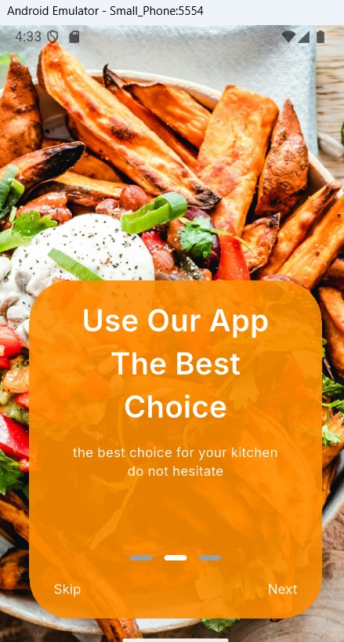
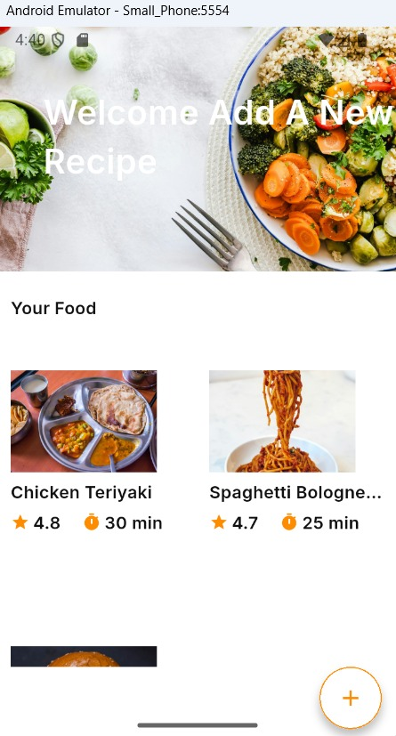
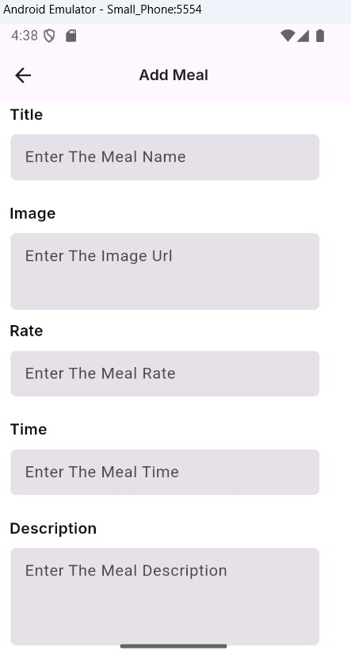
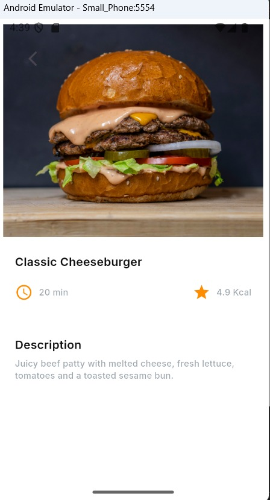

# Meals App 🍽️

A Flutter meal application that allows users to add and browse their own meals through a clean and simple mobile interface.

Each meal includes a title, image URL, rating, preparation time, and description. Meal data is saved locally on the device using SQLite, so users can reopen the app and see their saved meals.

---

## 📱 Screenshots

> Screenshots are stored in the `protifilo/shots` folder.

| Onboarding Screen | Home Screen |
|-------------------|-------------|
|  |  |

| Add Meal Screen | Meal Details Screen |
|-----------------|---------------------|
|  |  |

---

## ✨ Features

- Introductory onboarding carousel with Next and Skip actions
- Remembers onboarding status using `SharedPreferences`
- Display saved meals in a two-column grid
- Add a meal with a title, image URL, rating, time, and description
- Validate required fields in the Add Meal form
- View meal details on a separate screen
- Store meal records locally with SQLite
- Navigate between screens using GoRouter
- Load meal images from image URLs
- Responsive sizing with Flutter ScreenUtil

---

## 🛠️ Technologies Used

- Flutter
- Dart
- SQLite (`sqflite`)
- `path`
- `shared_preferences`
- `go_router`
- `flutter_screenutil`
- `carousel_slider`
- `dots_indicator`
- `google_fonts`
- `cached_network_image` (declared in `pubspec.yaml`)

---

## 📂 Project Structure

```text
lib/
├── Core/
│   ├── Contants/
│   │   └── constants.dart
│   ├── DB/
│   │   ├── db_helper.dart
│   │   └── task_model.dart
│   ├── Networking/
│   │   ├── api_endpoints.dart
│   │   └── dio_helper.dart
│   ├── Routing/
│   │   ├── App_Routes.dart
│   │   └── router_gen.dart
│   └── Styling/
│       ├── Widgets/
│       │   └── Spacing.dart
│       ├── app_assets.dart
│       ├── app_color.dart
│       ├── app_style.dart
│       └── app_theme.dart
├── Feature/
│   ├── AddMealScreen/
│   │   ├── Widget/
│   │   │   ├── CustomButton.dart
│   │   │   └── CustomTextField.dart
│   │   └── AddMealScreen.dart
│   ├── DetailsScreen/
│   │   └── DetailsScreen.dart
│   ├── MainScreen/
│   │   └── MainScreen.dart
│   └── OnBoardingScreen/
│       ├── Widgets/
│       │   ├── Crasoulslider.dart
│       │   ├── CustomContent.dart
│       │   └── DotsIndicator.dart
│       └── OnBoardingScreen.dart
└── main.dart
```

---

## 🚀 Getting Started

To run the project locally:

### 1. Clone the repository

```bash
git clone <YOUR_REPOSITORY_URL>
```

### 2. Open the project folder

```bash
cd meals_app
```

### 3. Install dependencies

```bash
flutter pub get
```

### 4. Run the app

```bash
flutter run
```

Make sure Flutter is installed and an Android emulator or physical device is configured.

---

## 💾 Local Storage

The app uses SQLite through `sqflite` to save meal information on the device. The current implementation creates a local table named `tasks` with fields for the meal title, rating, time, description, and image URL. `SharedPreferences` stores whether onboarding has been seen.

Meal images are entered as URLs, so an internet connection is needed to load remote images.

---

## 🖼️ Screenshot File Names

```text
protifilo/shots/OnboardingScreen.jpeg
protifilo/shots/HomeScreen.jpeg
protifilo/shots/AddMealScreen.jpeg
protifilo/shots/MealDetailsScreen.jpeg
```

---

## 👨‍💻 Developer

Developed by **Kirolos Emad**

GitHub: [kero12-eg](https://github.com/kero12-eg)

---

## 📄 License

This project is for learning and portfolio purposes.
