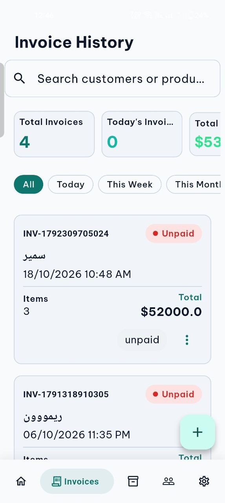

# Masiter | مسيطر — Business Management App

## Project Overview

**Masiter** is a Flutter application designed to help shops and small businesses manage daily operations from one organized workspace. Instead of keeping product records, invoices, customer information, inventory updates, and outstanding balances in separate paper records, Masiter brings these workflows together in a single application.

The app combines product and inventory management with sales invoicing, customer records, receivables tracking, and business-data sharing. It supports **Arabic and English**, including right-to-left (RTL) layouts for Arabic, and offers both **light and dark themes**. The application is available for Android and the web.

Masiter is a collaborative project developed by **Kirolos Emad** and **Rimon Abdelmasih**.

---

## 🎯 Project Goals

The project focuses on making common business-management tasks easier to organize and follow up on. Its main goals are to:

- Bring products, inventory, invoices, customers, and outstanding balances into one workflow.
- Help business owners monitor stock levels and identify low-stock products.
- Simplify sales invoice creation and provide practical PDF and print options.
- Keep customer details, purchase history, and receivables connected.
- Support tracking payments against outstanding invoices.
- Make the application usable for Arabic- and English-speaking users.
- Provide access from mobile devices and the web with a consistent user experience.

---

## ✨ Key Features

### 📦 Products & Inventory

Organizes products by details such as category and unit. Product images are stored with Supabase Storage, while inventory tools help users follow stock levels and receive low-stock notifications.

### 🧾 Sales Invoices

Supports creating and managing sales invoices. Invoices can be exported as PDF and prepared for printing on several common paper formats:

- **58 mm thermal paper**
- **80 mm thermal paper**
- **A4 paper**

### 👥 Customers & Purchase History

Keeps customer information and purchase history together, helping users review customer activity without relying on separate records.

### 💰 Receivables & Debt Collection

Tracks outstanding balances and debts. When a customer makes a payment, the application applies it to the oldest outstanding invoice first, supporting a consistent collection workflow.

### 🔔 Reminders & Stock Notifications

Provides low-stock notifications and morning reminders related to outstanding receivables, helping users follow up on important business tasks.

### 🤝 Business Data Sharing

Includes an email-based sharing mechanism that allows business data to be shared with another account.

### 🔐 Authentication & Account Access

Uses Firebase Authentication for account registration and sign-in, including email verification.

### 🌐 Arabic & English Localization

Supports English and Arabic, including RTL layout support for Arabic interfaces.

### 🎨 Light & Dark Themes

Offers light and dark themes so users can choose the appearance that suits their environment.

### 📱 Responsive Mobile & Web Experience

Provides responsive layouts for Android and web, alongside cached product-image loading with error handling.

---

## 📱 Screenshots

The screenshots below are referenced from the project's `docs/screenshots/` directory. If this portfolio document is stored inside `protiflo/`, the paths use `../docs/` to reach the project-level screenshots folder.

### Mobile — Dashboard & Invoices

| Dashboard — English, Light | Invoices — English, Light |
|:---:|:---:|
|  |  |

### Mobile — Themes & Localization

| Dashboard — English, Dark | Dashboard — Arabic, Light |
|:---:|:---:|
|  |  |

### Web Application

  

[View the full screenshot gallery](../project-masiter.html#screenshots)

---

## 🛠️ Technologies Used

| Area | Technologies |
|---|---|
| Application development | Flutter, Dart |
| State management | `flutter_bloc` (BLoC/Cubit) |
| Navigation | `go_router` |
| Dependency injection | `get_it` |
| Responsive layouts | `flutter_screenutil`, `responsive_framework` |
| Localization | `easy_localization` |
| Authentication | Firebase Authentication |
| Cloud database | Cloud Firestore |
| Product-image storage | Supabase Storage |
| PDF generation & printing | `pdf`, `printing` |
| Image loading | `cached_network_image` |
| Local preferences & secure storage | `shared_preferences`, `flutter_secure_storage` |
| Web deployment | Firebase Hosting |

---

## 🏗️ Architecture & Implementation

Masiter separates presentation and data responsibilities to keep the codebase organized as the application grows.

- **BLoC/Cubit** manages application and UI state.
- **GetIt** provides dependency injection and access to registered services.
- **GoRouter** organizes navigation between application screens.
- **Firebase Authentication** provides account access and email-verification support.
- **Cloud Firestore** stores cloud-backed business data.
- **Supabase Storage** stores product images.
- **PDF and printing libraries** support invoice export and printing.
- **Localization resources** support English and Arabic, including RTL presentation.

This combination brings together client-side state management, cloud-backed data, image storage, and document generation in a cross-platform Flutter application.

---

## 🌍 Supported Platforms & User Experience

- **Platforms:** Android and Web
- **Languages:** English and Arabic (RTL support)
- **Themes:** Light and Dark
- **Invoice formats:** 58 mm thermal, 80 mm thermal, and A4
- **Data access:** Cloud-backed workflows for supported application features

---

## 💡 Challenges & Learning Outcomes

Working on Masiter provides experience with business workflows that involve multiple related data entities, rather than isolated screens.

### Managing Connected Business Data
Products, invoices, customers, inventory, and outstanding balances need to stay consistent as users perform day-to-day operations.

### Authentication & Cloud Integration
Firebase Authentication and Cloud Firestore provide account access and cloud-backed data workflows, while Supabase Storage handles product images.

### Invoice Generation & Printing
Supporting multiple invoice formats requires invoice data to be presented in a layout suitable for both PDF export and different paper widths.

### Localization & RTL
Supporting Arabic and English requires attention to layout direction and readable interfaces across different languages.

### Cross-Platform UI
Android and web support requires responsive interfaces that remain usable across different screen sizes and input environments.

---

## 🚀 Potential Future Improvements

Possible areas for future development include expanding automated tests around invoice and receivables workflows, improving reporting and business analytics, and further strengthening error handling for network-dependent operations. These are potential enhancements, not claims about features currently available.

---

## 👨‍💻 Project & Developer

**Project:** Masiter | مسيطر  
**Category:** Business Management Application  
**Role:** Flutter Developer — collaborative project  
**Developers:** Kirolos Emad and Rimon Abdelmasih

- **Live Web App:** [masiter.web.app](https://masiter.web.app/)
- **Android APK:** [Download v1.0.0](https://github.com/rimonnnn/Warshity/releases/download/v1.0.0/app-release.apk)
- **GitHub Releases:** [View releases](https://github.com/rimonnnn/Warshity/releases)
- **GitHub Profile:** [@kero12-eg](https://github.com/kero12-eg)

---

## 📄 Project Scope

Masiter is a collaborative business-management project. Features described here are based on the supplied GitHub README. Availability of the app, release links, and external backend services depends on their current configuration and status.
